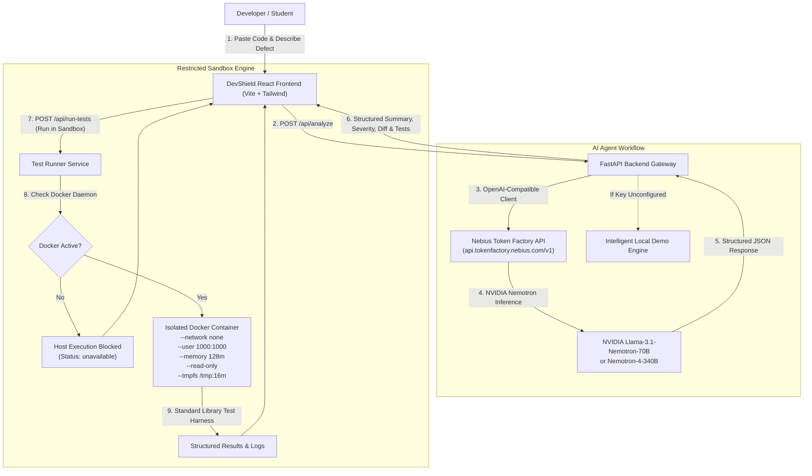

# DevShield AI — AI-Powered Python Debugging & Sandboxed Verification Agent

[](https://nebius.com)
[]()
[](https://fastapi.tiangolo.com)
[](https://vitejs.dev)
[-76B900?style=flat&logo=nvidia)](https://tokenfactory.nebius.com)
[](https://docker.com)

> **"Find bugs. Fix them with confidence."**  
> DevShield AI is an intelligent developer assistant that turns code debugging into a structured, reviewable, and test-verified engineering workflow.

---

## 1. Project Overview & Problem Statement

### The Problem
When developers ask large language models to debug code, standard chat interfaces often deliver unverified code suggestions without:
1. Explaining the true root cause of failure.
2. Providing a clear visual diff between original and proposed code.
3. Generating automated regression tests to validate the fix.
4. Testing the solution in a safe, sandboxed runtime before deployment.

### The Solution: DevShield AI
DevShield AI introduces a **visible, verifiable 4-step debugging loop**:
1. **Detect & Diagnose:** Deep inspection of Python code and error descriptions powered by high-performance NVIDIA open models hosted on Nebius Token Factory.
2. **Reviewable Diff:** Side-by-side patch visualization showing exact additions and modifications, with 1-click **Download .py**, **Copy**, and **Apply Fix** actions.
3. **Automated Test Generation:** Generates targeted test suites covering nominal behavior, edge cases, and runtime exceptions.
4. **Sandboxed Container Verification:** Executes unit tests inside an ephemeral, non-root, network-isolated Docker sandbox with hard CPU and memory quotas. If Docker is unavailable, host execution is blocked to safeguard the developer's machine.

---

## 2. System Architecture



---

## 3. Technology Stack

* **Frontend:**
  * React 19 + Vite 8
  * Tailwind CSS v4
  * Lucide React Icons
  * Modern Responsive Dark Navy & Purple Glassmorphic UI
* **Backend:**
  * Python 3.11+ / Python 3.14 compatible
  * FastAPI
  * Pydantic v2 (Input validation & response schemas)
  * Uvicorn ASGI Server
  * Pytest + HTTPX for automated testing
* **AI Integration:**
  * **Nebius Token Factory API** (OpenAI-compatible client)
  * Supported & Configurable NVIDIA Models:
    * `nvidia/Llama-3.1-Nemotron-70B-Instruct-HF` (Default)
    * `nvidia/Nemotron-4-340B-Instruct`
    * `nvidia/Nemotron-3_5-Lightning`
* **Security & Isolation:**
  * Ephemeral Docker Container Runner (`python:3.11-slim`)
  * Security restrictions: `--network none`, `--user 1000:1000`, `--memory 128m`, `--cpus 0.5`, `--pids-limit 30`, `--read-only`, `--tmpfs /tmp:rw,noexec,nosuid,size=16m`.

---

## 4. API Endpoints Reference

| Method | Endpoint | Description |
|---|---|---|
| `GET` | `/health` | Top-level system health check & AI status |
| `GET` | `/api/health` | Service health & runner readiness |
| `GET` | `/api/config/status` | Public configuration metadata (redacts all secrets) |
| `POST` | `/api/analyze` | AI & Demo root-cause diagnosis, patch & test generation |
| `POST` | `/api/generate-tests` | Dedicated test case synthesis endpoint |
| `POST` | `/api/validate-patch` | Safe AST syntax validation & diff metrics |
| `POST` | `/api/run-tests` | Isolated Docker container test execution |

---

## 5. Local Installation & Setup

### Project Root Directory Note
The project is organized in the `DevShield-AI` folder:
```
devshield/
└── DevShield-AI/
    ├── frontend/
    ├── backend/
    ├── docker/
    └── docker-compose.yml
```

Open a **Windows PowerShell** terminal at `devshield\DevShield-AI`:
```powershell
cd DevShield-AI
```

### Backend Setup

1. **Navigate to backend and create virtual environment:**
```powershell
cd backend
python -m venv .venv
```

2. **Activate the virtual environment:**
```powershell
.\.venv\Scripts\Activate.ps1
```

3. **Install dependencies:**
```powershell
pip install -r requirements.txt
```

4. **Configure environment variables:**
Copy the example environment template:
```powershell
Copy-Item .env.example .env
```
Open `.env` in your text editor and customize if you have a Nebius API key:
```ini
NEBIUS_API_KEY=your_actual_nebius_api_key_here
NEBIUS_BASE_URL=https://api.tokenfactory.nebius.com/v1/
NEBIUS_MODEL=nvidia/Llama-3.1-Nemotron-70B-Instruct-HF
HOST=127.0.0.1
PORT=8000
```
> **Note:** If `NEBIUS_API_KEY` is left blank, DevShield AI automatically and transparently operates in **Demo Mode**.

### Frontend Setup

1. **Open a new PowerShell terminal and navigate to frontend:**
```powershell
cd DevShield-AI\frontend
```

2. **Install dependencies:**
```powershell
npm install
```

---

## 6. Starting the Application

### 1. Launch the Backend Server
In the backend PowerShell terminal (with `.venv` activated):
```powershell
cd backend
uvicorn app.main:app --reload --port 8000
```
* **API Server:** [http://127.0.0.1:8000](http://127.0.0.1:8000)
* **Interactive OpenAPI Docs:** [http://127.0.0.1:8000/docs](http://127.0.0.1:8000/docs)
* **Health Check:** [http://127.0.0.1:8000/health](http://127.0.0.1:8000/health)

### 2. Launch the Frontend Development Server
In the frontend PowerShell terminal:
```powershell
cd frontend
npm run dev
```
* **Web Application:** [http://localhost:5173](http://localhost:5173)

---

## 7. Nebius Token Factory & NVIDIA Model Configuration

DevShield AI communicates with Nebius Token Factory via its **OpenAI-compatible inference endpoint**:

```python
from openai import OpenAI

client = OpenAI(
    base_url=os.environ.get("NEBIUS_BASE_URL", "https://api.tokenfactory.nebius.com/v1/"),
    api_key=os.environ.get("NEBIUS_API_KEY"),
)
```

### Supported NVIDIA Models:
| Model ID | Description | Ideal For |
|---|---|---|
| `nvidia/Llama-3.1-Nemotron-70B-Instruct-HF` | High-accuracy coding and reasoning model | **Default** — Deep bug diagnosis and patch synthesis |
| `nvidia/Nemotron-4-340B-Instruct` | Massive-parameter MoE model for complex logic | Multi-file or complex architectural defects |
| `nvidia/Nemotron-3_5-Lightning` | Ultra-low latency variant | Fast interactive debugging feedback |

To change the active model, set `NEBIUS_MODEL` in `backend/.env`.

---

## 8. Demo Mode vs. Live AI Mode

DevShield AI is built with an **explicit, un-faked demo mode**:
* **Live AI Mode:** Activated when `NEBIUS_API_KEY` is provided in `backend/.env`. Communicates directly with the configured NVIDIA model on Nebius Token Factory. The UI displays a glowing purple badge labeled `Nebius AI`.
* **Demo Mode:** Activated when `NEBIUS_API_KEY` is empty. The UI and API clearly label every response with `mode: "demo"` and display an amber banner. Synthesizes context-aware debugging analysis for common Python bug classes (`ZeroDivisionError`, `IndexError`, mutable default arguments) so developers and hackathon judges can explore the complete application workflow without API credentials.
* **Failure Guard:** If Nebius AI rate limits, credentials, or network errors occur, the backend never silently replaces them with fake answers; it reports meaningful, secure HTTP error diagnostics (401, 429, 502, 504).

---

## 9. Security & Restricted Python Execution

Executing user-supplied Python code is a critical security concern. DevShield AI implements **defense-in-depth isolation**:

1. **Host Execution Prohibition:** Untrusted code is **never executed directly on the host** or in the FastAPI worker process.
2. **Ephemeral Containers:** Tests run in fresh, temporary containers destroyed immediately after completion (`--rm`).
3. **No Network Access:** Containers run with `--network none` to prevent unauthorized outbound connections or data exfiltration.
4. **Unprivileged User:** Execution runs under non-root UID `1000:1000`.
5. **Resource Quotas:** Memory is capped at `128MB`, CPU quota at `0.5`, and process count at `30` to prevent fork bombs and memory starvation.
6. **Read-Only Root Filesystem:** Filesystem is mounted read-only (`--read-only`), with a small restricted `/tmp` tmpfs (`16MB`, `noexec`, `nosuid`).
7. **Timeout Limits:** Hard 5-second process timeout kills stuck or infinite loops.
8. **No Directory Mounts:** Code is passed to the container directly via `stdin` (`python -u -`), eliminating the need to mount any host directories or expose secrets.
9. **Prompt Injection Hardening:** Untrusted code and bug descriptions are passed as inert data payloads within a hardened system prompt preventing model subversion.
10. **Graceful Safety Block:** If Docker daemon is stopped, execution is rejected with `status: unavailable`, maintaining complete host integrity.

---

## 10. Automated Testing

All unit tests are completely self-contained and **never require a paid API key or active network connection**:

```powershell
cd backend
.\.venv\Scripts\Activate.ps1
pytest tests -v
```

### Test Suite Coverage (19 Tests Passing):
* `test_health.py`:
  * Root health check endpoint (`/` and `/health`)
  * Configuration status endpoint (`/api/config/status`)
  * Health response in Demo mode
  * Health response in AI configured mode (verifying API keys are never exposed)
* `test_analyze.py`:
  * Pydantic request body validation (rejects blank code and descriptions)
  * Demo mode response formatting, severity, and limitations
  * Dedicated test generation endpoint (`/api/generate-tests`)
  * Safe AST patch validation endpoint (`/api/validate-patch`)
  * Mocked live AI analysis pipeline
  * AI malformed JSON recovery and error handling
  * Nebius provider errors (AuthenticationError 401, RateLimitError 429, APITimeoutError 504)
* `test_runner.py`:
  * Security check: Docker unavailable blocks execution safely
  * Mocked container execution and JSON test result parsing
  * Execution timeout enforcement

---

## 11. 3-Minute Demo Video Outline

For hackathon judges and evaluators, follow this concise demonstration structure:

* **[0:00 – 0:35] The Problem & DevShield AI Value Proposition**
  * Introduce DevShield AI as a structured, reviewable debugging assistant built for Track 1: Coding & Agentic Engineering.
  * Show the UI architecture: dark navy theme, live AI status indicator, and isolated container sandbox telemetry.
* **[0:35 – 1:20] The Core Debugging Loop**
  * Select a sample preset (e.g., `ZeroDivisionError` or `Mutable Default Argument`) or paste defective Python code.
  * Click **"Analyze Code & Formulate Patch"**.
  * Highlight the structured output: Defect Summary, Root Cause Analysis, Severity Badge, and Location.
* **[1:20 – 1:55] Reviewable Patch & Code Comparison**
  * Showcase the side-by-side diff viewer showing exact additions and modifications.
  * Demonstrate the **"Apply Fix"** button updating the workspace code and the **"Download .py"** action.
* **[1:55 – 2:35] Sandbox Test Verification & Security Integrity**
  * Walk through the generated unit tests (verifying edge cases and expected outcomes).
  * Click **"Run Tests in Sandbox"**.
  * Demonstrate honest security: show the Docker sandbox status, pass/fail progress, execution duration (ms), and terminal logs. Explain that untrusted code is never run directly on the host.
* **[2:35 – 3:00] Nebius Token Factory Setup & Hackathon Compliance**
  * Briefly open `backend/.env.example` to demonstrate the OpenAI-compatible Nebius Token Factory configuration with `nvidia/Llama-3.1-Nemotron-70B-Instruct-HF`.
  * Highlight that all API keys are strictly kept server-side and never exposed to the frontend.

---

## 12. License

Distributed under the **MIT License**. See `LICENSE` for more information.
